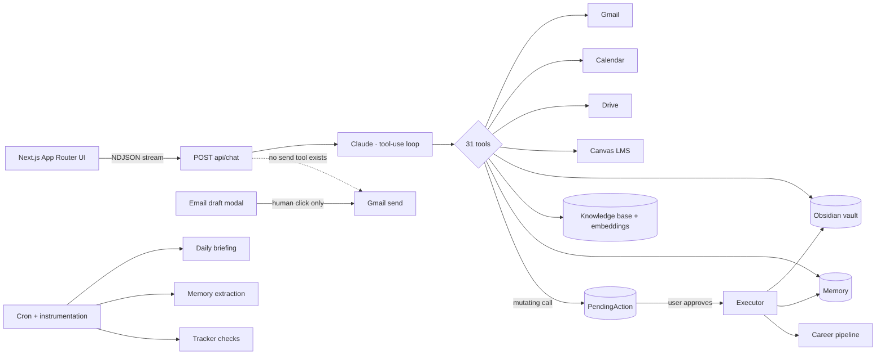
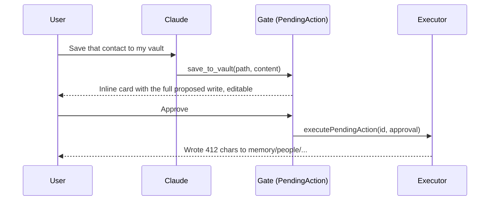

<div align="center">

# Hatch

**A personal AI secretary that can read everything and write nothing without asking.**

Streaming Claude agent with 31 tools over email, calendar, files, coursework and a personal knowledge vault, plus a provenance-checked résumé pipeline that cannot invent a number.

[](https://github.com/anuhtole/hatch/actions/workflows/ci.yml)


</div>

---

## Why this exists

Most "AI assistant" demos are a chat box with a few tools bolted on. The hard part of a *useful* secretary is the opposite: it needs deep, persistent access to your life (inbox, calendar, Drive, LMS, notes) while being structurally incapable of doing damage on its own.

Hatch is my answer to that, built and used daily since April 2026. Two design commitments drive everything:

1. **Nothing writes silently.** Every mutating action the model proposes is persisted as a `PendingAction` row and rendered as an inline card. It executes only when the user clicks approve. Email sending is not even a tool: the model can draft, and only a human click in the draft modal can send.
2. **Nothing is fabricated.** The résumé/cover-letter pipeline draws from a deterministic, provenance-tagged pool of real claims. Eight guard scripts check that every number, tool name and technique in the output traces back to a cited source claim, or the build fails.

## What it does

| Area | Capability |
|---|---|
| **Agent** | Streaming Claude chat (NDJSON) with 31 model-callable tools, persisted conversations, tool-call loop with a stall watchdog |
| **Integrations** | Gmail (multi-account), Google Calendar, Google Drive, Canvas LMS, web search, local Obsidian vault |
| **Memory** | Idle-conversation fact extraction into a structured `Memory` table; user-curated facts are protected from auto-overwrite; confidence decay on stale facts |
| **Knowledge base** | Ingests email, Drive, Canvas and uploads; embeds with `text-embedding-3-small`; cosine-similarity retrieval injected into chat context |
| **Trackers** | Natural-language "watch this" monitors (job postings, URLs, topics) checked on a schedule with status history |
| **Daily briefing** | Eight-section morning brief: calendar, priority email, assignments, tracker changes, markets, tech news, career, vault activity |
| **Career ops** | Job-board scanning, posting evaluation, application pipeline with stages and follow-ups, LinkedIn CSV import with LLM contact enrichment |
| **Résumé studio** | JD → tailored one-page `.docx` + cover letter + gap report, grounded entirely in the vault, with visual QA |

## Architecture



**Stack:** Next.js 16 (App Router), React 19, TypeScript strict, Prisma 7 on SQLite/libSQL, Anthropic SDK, Google APIs, `docx` for rendering. 107 API route handlers, 21 Prisma models, ~47k lines of application TypeScript.

### The trust layer



- `lib/pending-actions.ts` is the single executor. Vault writes, memory writes and pipeline updates all route through it.
- `scripts/check-send-surface.ts` is a CI guard that greps the source and fails the build if the Gmail send API appears outside `lib/gmail.ts`, if `sendEmail` is called anywhere except the executor, or if any bulk-approve path exists. The rule is enforced structurally, not by prompt.
- `lib/models.ts` is the only file allowed to contain a model string (`guard:models`), so routing changes are one-line diffs.

### The résumé pipeline (`lib/resume/`)

48 modules (pipeline stages, 8 guards, runnable fixtures) behind one shared runner (`run-pipeline.ts`) used by both the CLI and the in-app studio. Stages stream to the UI as they pass or fail:

```
fetch target (Ashby / Greenhouse / Lever APIs, or pasted JD)
  → ground truth (vault .md with frontmatter → provenance-tagged claim pool)
  → research (web search → emphasis + gap questions only; cannot add claims)
  → SELECT (ranked, hygiene-filtered) → REPHRASE (acceptance gate: numeric + drift check per bullet, verbatim fallback)
  → sections (education / coursework / skills ∩ grounded set)
  → one-page fit (calibrated Times-AFM width measure, balanced trim)
  → render .docx (exact canonical format) → cover letter (per-sentence provenance)
  → gap report (STRONG / WEAK / ABSENT coverage, digit-free open questions)
  → guards
```

| Guard | What it proves |
|---|---|
| `check-provenance` | every number in every bullet exists in its source claim |
| `check-resume-drift` | no JD term grafted into a bullet that lacks it at the source |
| `check-cover-letter` | every tool, technique and number in the letter cites a résumé bullet |
| `check-membership` | education and additional sections contain only grounded items |
| `check-format-parity` | rendered `.docx` carries the canonical treatment: page size, margins, header, section signatures, Garamond runs, page count |
| `check-ats` | single-column flow, standard headings in order, contact line and role/date tabs extract cleanly |
| `check-visual` | vision-model QA on the rendered page; remediation is layout-only |
| `check-outreach` | outreach drafts: recipient facts cite fetched sources, engagement claims need a user-stated vault claim, attachment hash matches the last green run |

The gap report is deliberately digit-free: when the JD asks for something the vault doesn't cover, Hatch asks the user an open question rather than proposing a specific it could be tempted to "confirm".

## Running it

```bash
git clone https://github.com/anuhtole/hatch.git && cd hatch
npm install
cp .env.example .env        # add ANTHROPIC_API_KEY; Google / Canvas / OpenAI are optional
npx prisma db push && npx prisma generate
npm run dev                 # http://localhost:3000
```

Google integrations need an OAuth client with Gmail, Calendar and Drive scopes; connect accounts from Settings. Canvas needs a personal access token. The vault is any folder of Markdown with frontmatter (`VAULT_PATH`, defaults to `~/vault`).

```bash
npm run guard:send-surface   # structural send-surface assertions
npm run guard:models         # no model strings outside lib/models.ts
npm run resume:e2e           # full résumé pipeline against targets/example.json
```

## Project layout

```
app/api/            107 route handlers (chat, auth, email, calendar, canvas, knowledge, memory, resume, trackers, cron …)
app/                pages: home, chats, knowledge, memory, resume studio, career
components/         inline-styled React (no utility classes in JSX), chat cards, pending-action card, résumé studio
lib/claude.ts       system prompt + tool registry
lib/pending-actions.ts   the one executor for mutating actions
lib/resume/         résumé pipeline + 8 guards
lib/{gmail,google-calendar,google-drive,canvas,vault,indexer,memory,tracker,daily-briefing}.ts
prisma/schema.prisma     21 models
scripts/            CI guards and measurement
```

## Design notes

- **Server components by default;** client components only where interactive.
- **Inline `style={{}}` everywhere.** Warm-paper light theme, EB Garamond body, JetBrains Mono labels.
- **Loud failure over silent null.** Structured outputs (`lib/resume/structured.ts`) throw with stage name, stop reason and raw response head on every null path.
- **Keys stay server-side.** Every provider call lives in an API route.

## Status

In daily personal use. The 2026-06 pivot narrowed the UI to deep chat with persistent memory and the résumé studio; the briefing, trackers, markets and career dashboard modules remain in the codebase behind `lib/feature-flags.ts`.

Companion project: [Spine](https://github.com/anuhtole/Spine), a control plane for autonomous agents (deterministic policy enforcement, tamper-evident audit log), accepted to the NeurIPS 2026 AgenticLS workshop. Hatch is where the human-in-the-loop ideas were first lived with; Spine is where they were formalized.

Built with [Claude Code](https://claude.com/claude-code).

## Author

**Anatole Seychal** · UC Berkeley, Applied Mathematics + Data Science + Political Economy · PM at Microsoft (Copilot Studio, Power Apps AI Reviewer Agent), PitchBook, Nielsen, Dialpad
[anuhtole.github.io](https://anuhtole.github.io) · [LinkedIn](https://linkedin.com/in/anatole-seychal)

MIT licensed.
